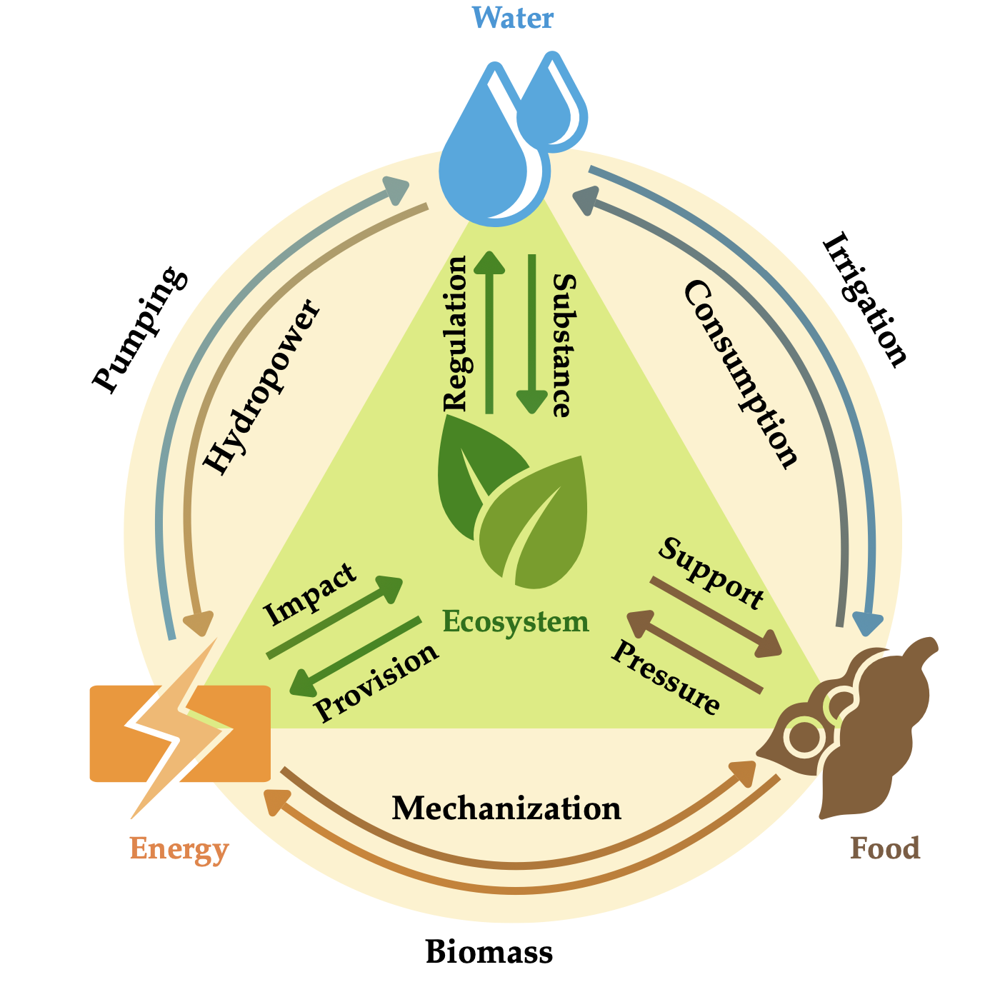
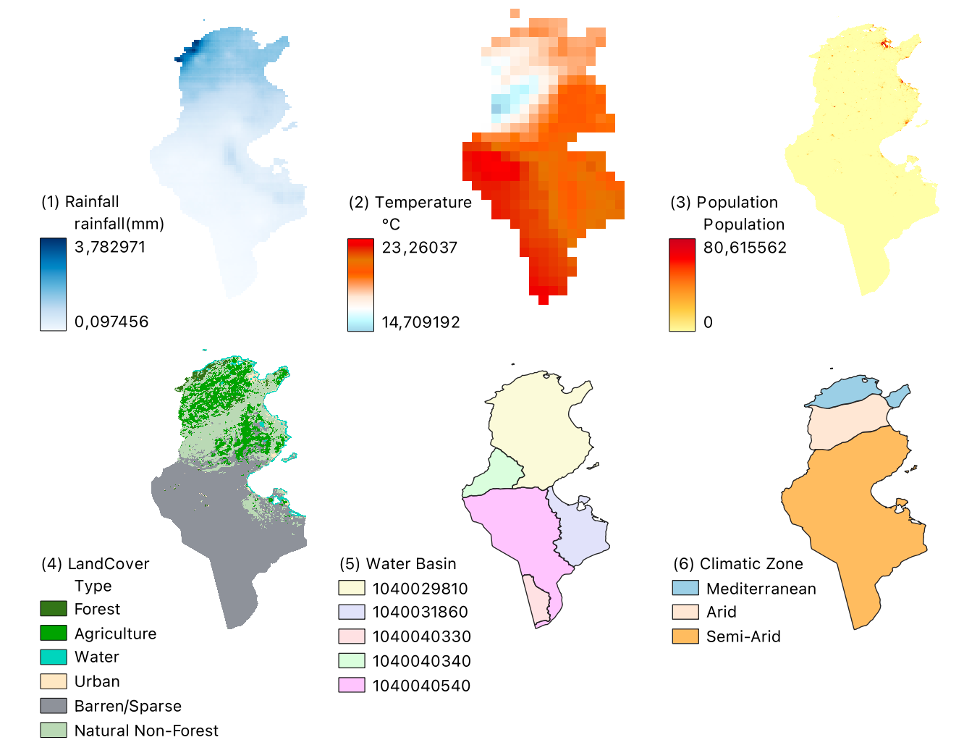
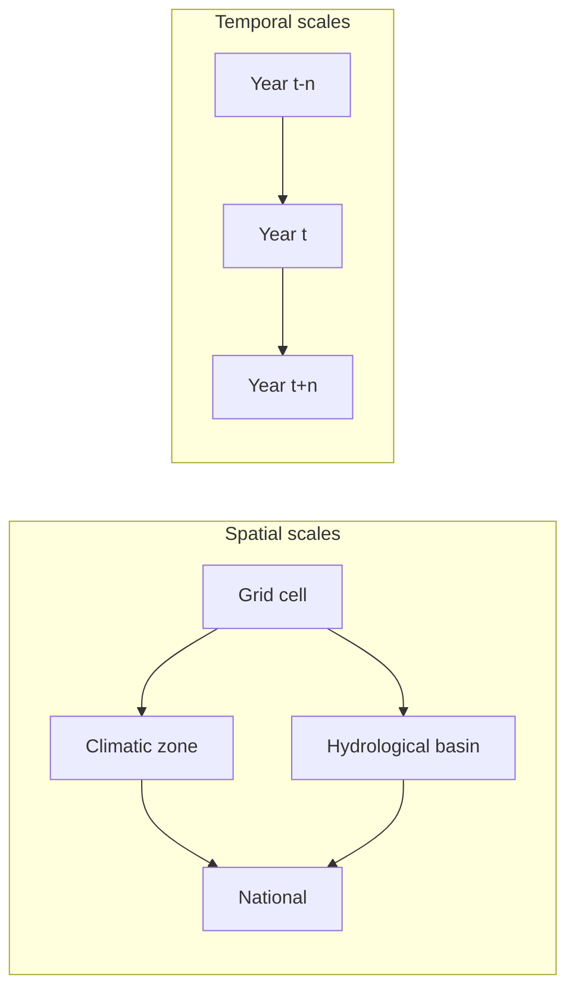
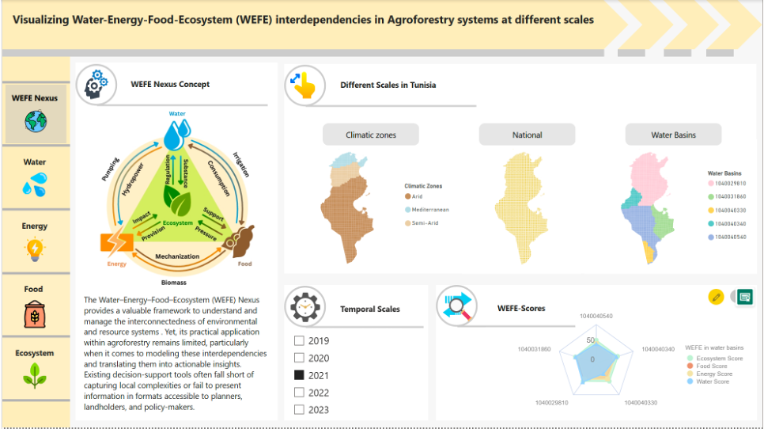

# Tunisia WEFE Nexus — Spatial Climate-Resilience Indicators


> A reproducible, spatially explicit framework for quantifying 
>
> **Water–Energy–Food–Ecosystem (WEFE) Nexus**
>
>  interdependencies and mapping 
>
> **climate-resilience hotspots**
>
>  across agroforestry landscapes in Tunisia.

This repository accompanies a **Master's thesis** conducted within the **TRANS-SAHARA Horizon Europe** project and was awarded the **AGIT 2025 Best Poster Award**. The original research notebook has been refactored into a modular, reproducible Python/SQL workflow that harmonises multi-source environmental and socio-economic data, computes composite spatial resilience indicators, and feeds an interactive map-based decision-support dashboard built with **QGIS** and **Power BI**.


***

## Table of Contents


1. [Why climate resilience?](#1-why-climate-resilience)
2. [The WEFE Nexus approach](#2-the-wefe-nexus-approach)
3. [Repository structure](#3-repository-structure)
4. [Data inputs](#4-data-inputs)
5. [Installation](#5-installation)
6. [Usage](#6-usage)
7. [Methodology](#7-methodology)
8. [Outputs](#8-outputs)
9. [Indicators at a glance](#9-indicators-at-a-glance)
10. [Key findings](#10-key-findings)
11. [Limitations](#11-limitations)
12. [Reproducing and extending](#12-reproducing-and-extending)
13. [Citation](#13-citation)
14. [Acknowledgements](#14-acknowledgements)
15. [License](#15-license)

***

## 1. Why climate resilience?

Tunisia's agroforestry landscapes sit at the intersection of intensifying **climatic pressure**—rising temperatures, highly variable rainfall, drought and water stress—and structural **socio-economic pressure** on water, energy and food security. Building resilience means understanding not only how exposed each place is to these shocks, but how the underlying resource systems *interact*: a drought does not affect water alone, but propagates into irrigation, energy demand for pumping, agricultural productivity, and the health of ecosystems that buffer all three.

Single-sector indicators miss these linkages. This project instead operationalises climate resilience **spatially**: every grid cell receives a transparent, comparable score that combines resource availability, access and pressure, making it possible to answer place-based questions such as:

* *Where* do water, energy and food constraints converge into **resilience hotspots**?

* *Where* do synergies between sectors offer opportunities for sustainable agroforestry?

* *How* do these patterns shift across years and in response to climatic fluctuations or policy interventions?

## 2. The WEFE Nexus approach

The **WEFE Nexus** captures the interdependencies among four critical systems—**Water, Energy, Food and Ecosystems**—that are essential for sustainable development. The framework is pillar-agnostic: indicators are grouped into pillars, and new pillars or indicators are added through metadata rather than by rewriting analysis code.



The analysis combines **spatial data modelling** with **cartographic communication** to make these complex interconnections legible to farmers, planners and policymakers.

## 3. Repository structure

```
TUN-WEFE-Nexus/

├── main.py                  # Entry point: runs the full pipeline
├── requirements.txt
├── LICENSE
├── README.md
├── src/
│   ├── config.py            # Paths, year and analysis parameters
│   ├── data\_loader.py      # Load spatial layers and indicator tables
│   ├── metadata.py          # Indicator dictionary (pillar, assignment, direction)
│   ├── indicators.py        # Assignment, min-max normalization, weighted mean
│   ├── aggregation.py       # National / zone / basin rollups
│   └── pipeline.py          # End-to-end orchestration
├── data/                    # Place inputs here (see data/README.md)
├── figures/                 # Maps and dashboard screenshots
└── notebooks/
    └── TUN\_WEFE.ipynb      # Original research notebook (kept for reference)
```

## 4. Data inputs
The pipeline harmonises heterogeneous spatial and non-spatial datasets spanning hydrology, agriculture, energy access and ecosystem health. Raw data are not redistributed here; see [data/README.md](data/README.md) for the full schema. In brief:

* **Spatial layers** — a Tunisia grid (`TUN_cells_WGS84.shp`), hydrological basins (`TUN_WaterBasin_level04.shp`) and climatic zones (`TUN_ClimaticZone.shp`) and some ecosystem indicator data layers.
* 
* 

* **Indicator tables** — semicolon-separated CSVs for water, energy, and food, with an optional `data_year` column for multi-year analysis.

* **Metadata** — `indicator_metadata.csv` is generated automatically on first run.

## 5. Installation

```
\# 1. Clone the repository
git clone https://github.com/\<your-username>/TUN-WEFE-Nexus.git
cd TUN-WEFE-Nexus

\# 2. Create and activate a virtual environment
python -m venv .venv
source .venv/bin/activate        # Windows: .venv\Scripts\activate

\# 3. Install dependencies
pip install -r requirements.txt
```
Then place the input files in `data/` (or set `WEFE_DATA_DIR` to point at another folder). QGIS and Power BI are desktop applications used for map production and the dashboard, not Python dependencies.

## 6. Usage

```
\# Run the full pipeline for the default year (configured in src/config.py)
python main.py
```
The pipeline can also be called from Python, for example to loop over several years:
```
from src.pipeline import run\_pipeline
for yr in (2015, 2017, 2019):
  result = run\_pipeline(year=yr)
  print(result\["agg\_national"])
```

## 7. Methodology

### 7.1 Workflow overview

The implementation of this thesis was grounded in a systematic and reproducible workflow designed to transform disparate data sources into a cohesive geospatial framework for analyzing the WEFE Nexus. This methodological approach was structured into four distinct phases: Data Collection, Pre-processing, Modeling, and Visualization.


### 7.2 Multi-scale and multi-temporal design

The analysis is resolved across nested spatial scales and repeated over several years so that temporal variability is captured alongside spatial heterogeneity:



### 7.3 Indicator assignment

A metadata dictionary determines how each indicator is allocated to the grid. This keeps the logic data-driven and fully reproducible:


| Assignment           | How it is applied to a cell                                                                  | Example                                 |
| -------------------- | -------------------------------------------------------------------------------------------- | --------------------------------------- |
| `population`         | Constant value/% per cell, with population-weighted aggregation and a `_people_equiv` helper | Drinking water, electricity access, CO₂ |
| `national`           | Single national constant applied to every cell                                               | Freshwater withdrawals, energy imports  |
| `basin`              | Joined to the grid by `HYBAS_ID`; falls back to national if absent                           | IWRM score, environmental flows         |
| `climatic_zone`      | Joined by `clima_zone`; falls back to national if absent                                     | Renewable energy consumption            |
| `area` / `crop_area` | Area-weighted; cropland weighting uses `pct_crop`                                            | Precipitation, cereal yield             |

Each indicator also carries a **direction**: `pos` means a higher value contributes to resilience, while `neg` marks a pressure (e.g. withdrawals, imports, undernourishment, emissions) that is inverted during normalization.

### 7.4 Normalization and composite scoring


1. **Normalize** every indicator to `[0, 1]` with min-max scaling, inverting negative-direction indicators so that *higher always means more resilient*.

2. **Pillar score** = simple mean of the normalized indicators within a pillar.

3. **WEFE Nexus index** = mean of the pillar scores, giving each cell a single comparable resilience value.

### 7.5 Multi-scale aggregation and hotspot detection

Pillar and composite scores are aggregated to national, climatic-zone and basin levels using population or area weights. Comparing the composite index across cells and years identifies **nexus hotspots** where resource constraints and vulnerabilities converge, and **synergy areas** conducive to sustainable agroforestry management.

### 7.6 Decision-support dashboard

An interactive, map-based dashboard lets stakeholders explore nexus outcomes dynamically by **region, year and resource pillar**. The GeoJSON/CSV exports below are designed for the Power BI Shape Map (after converting GeoJSON to TopoJSON, e.g. with [mapshaper](https://mapshaper.org/)), while QGIS is used for cartographic production. The goal is to translate multidimensional data into accessible visual narratives that support participatory decision-making.

## 8. Outputs

All outputs are written to `data/Outputs/` (or `<WEFE_DATA_DIR>/Outputs/`):

| File                              | Contents                                                                   |
| --------------------------------- | -------------------------------------------------------------------------- |
| `wefe_grid_attributes_<year>.csv` | Per-cell normalized indicators, pillar scores and WEFE Nexus (no geometry) |
| `wefe_national_<year>.csv`        | National population-weighted rollup                                        |
| `wefe_climatic_zone_<year>.csv`   | Climatic-zone rollups (when the matching column exists)                    |
| `wefe_basin_<year>.csv`           | Basin rollups (when the matching column exists)                            |
| `wefe_grid_<year>.geojson`        | Geometry + scores, for the dashboard Shape Map                             |

## 9. Indicators at a glance

The published notebook implements **21 indicators** across the Water, Energy and Food pillars; the **Ecosystem** pillar is supported by the framework and can be populated by adding metadata rows.


| Pillar | Indicator                                     | Direction | Assignment     |
| ------ | --------------------------------------------- | --------- | -------------- |
| Water  | `pct_basic_drinking_water`                    | +         | population     |
| Water  | `pct_basic_sanitation`                        | +         | population     |
| Water  | `iwrm_implementation_score`                   | +         | basin          |
| Water  | `annual_freshwater_withdrawals_pct`           | −         | national       |
| Water  | `renewable_internal_freshwater_per_capita`    | +         | population     |
| Water  | `environmental_flow_requirements_million_m3`  | +         | basin          |
| Water  | `avg_precipitation_mm`                        | +         | area           |
| Energy | `access_to_electricity_pct`                   | +         | population     |
| Energy | `electric_power_consumption_kwh_per_capita`   | +         | population     |
| Energy | `renewable_energy_consumption_pct`            | +         | climatic\_zone |
| Energy | `renewable_electricity_output_pct`            | +         | national       |
| Energy | `energy_imports_net_pct`                      | −         | national       |
| Energy | `co2_emissions_per_capita`                    | −         | population     |
| Food   | `undernourishment_pct`                        | −         | population     |
| Food   | `avg_protein_supply_grams_per_capita_per_day` | +         | population     |
| Food   | `child_wasting_pct`                           | −         | population     |
| Food   | `child_stunting_pct`                          | −         | population     |
| Food   | `adult_obesity_pct`                           | −         | population     |
| Food   | `adesa_pct`                                   | +         | national       |
| Food   | `avg_food_production_value_per_capita`        | +         | population     |
| Food   | `cereal_yield_kg_per_hectare`                 | +         | crop\_area     |

## 10. Key findings

* **Critical hotspots** emerged where resource constraints and vulnerabilities converge, while other areas showed **synergies** favourable to sustainable agroforestry.

* Composite indicators and pillar-specific maps revealed strong **spatial heterogeneity and temporal dynamics** reflecting both environmental conditions and socio-economic factors.

* **Scenario comparisons** underscored the sensitivity of nexus outcomes to climatic fluctuations and policy interventions, reinforcing the case for integrated, place-based governance.



## 11. Limitations

As noted in the thesis, data limitations and methodological simplifications mean the framework should be treated as a flexible foundation rather than a finished product. Where indicators are available only as national constants, within-country variation is understated; ongoing refinement, finer-scale data, and **stakeholder co-production** are needed to strengthen the indicators and their interpretation.

## 12. Reproducing and extending


* **Add a year:** include it in the indicator tables (with `data_year`) and run `run_pipeline(year=...)`.

* **Add an indicator:** add a row to `src/metadata.py` (or the generated `indicator_metadata.csv`) and the matching value column.

* **Add the Ecosystem pillar:** add rows with `pillar='Ecosystem'`; the pipeline detects and scores any pillar automatically.

* **Change weighting:** select the population or area weight in the aggregation step.

## 13. Citation

If this work is useful, please cite the thesis (replace placeholders with the final bibliographic details):


```
@mastersthesis{tun\_wefe\_2025,

title  = {Visualizing Water-Energy-Food-Ecosystem (WEFE) Interdependencies at Different Scales},
author = {\<Qianyi Cao>},
year   = {2025},
school = {\<Technical University of Munich>},
note   = {TRANS-SAHARA Horizon Europe; AGIT 2025 Best Poster Award}
```

## 14. Acknowledgements

This research was carried out within the **TRANS-SAHARA Horizon Europe** project and recognised with the **AGIT 2025 Best Poster Award**. Sincere thanks to the supervisors, project partners, and stakeholders who contributed data, feedback, and local knowledge.

## 15. License

Code is released under the [MIT License](LICENSE). Please review the terms of the underlying third-party datasets before redistributing them.
